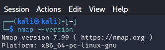

<div align="center">

# 🔐 Cybersecurity Week 1: Lab Environment Setup

**Developing a controlled virtual environment for cybersecurity testing and ethical hacking practice**

</div>

<p align="center">
   
  
 
  
  
  
  
  
  
</p>

---

## 📌 Project Overview

This lab focuses on creating a virtual environment using VirtualBox and Kali Linux. The goal is to establish a safe and isolated workspace where virtual systems can be deployed, configured, and connected to the internet without affecting the host system.

The environment provides a foundation for learning and practicing cybersecurity concepts in a controlled setting. It allows various systems and tools to be used for hands-on experience while maintaining a secure and organized network structure.

The lab is configured on a private virtual network, making it easy to expand in future exercises by adding additional virtual machines for testing, experimentation, and cybersecurity-related activities.

---


## 🎯 Objectives

The main objectives of this project are to:

- Install the required software, including 7-Zip and VirtualBox, and prepare the system for the lab environment.
- Create and configure a private NAT Network to support communication between virtual machines.
- Import and configure Kali Linux as the primary virtual machine for the lab setup.
- Configure the Kali Linux networking settings and verify successful internet connectivity.
- Create a virtual machine snapshot to provide a recovery point for future use.
- Document the setup process and configuration details completed during the lab.
- Build a stable foundation that can be expanded for future cybersecurity and penetration testing exercises.

---

## 🛡️ Purpose of the Lab

The virtual lab provides an isolated environment where cybersecurity techniques and tools can be practiced safely. It allows hands-on learning and experimentation while maintaining a controlled network setup.

Possible uses of the lab include:

- Gathering information about networked systems
- Scanning ports and services
- Performing vulnerability assessments
- Inspecting and analyzing network traffic
- Testing web application security
- Practicing security testing techniques
- Experimenting with cybersecurity tools and utilities
---

## 🏗️ Lab Architecture


*Figure 1: VirtualBox Lab Architecture*


---

## ⚙️ Lab Configuration

| 🧩 Component       | ⚙️ Configuration   |
| ------------------ | ------------------  |
| 🖥️ Host OS         | Windows 11       |
| 🧠 Host RAM        | 16.0 GB               |
| ⚡ Processor       | Intel(R) Core(TM) 7 150U     |
| 🧰 Hypervisor      | VirtualBox 7.2.22  |
| 🐉 Security OS     | Kali Linux 2026.3  |
| 🧠 Kali RAM        | 2048 MB            |
| 🌐 Virtual Network | NAT Network        |
| 📡 Network Address | 10.0.0.0/24        |
| 🐧 Kali IP Address | 10.0.0.2      |
| 🚪 Default Gateway | 10.0.0.1           |
| 🌍 DNS Server      | 8.8.8.8            |
| 🔮 Future VM Range | 10.0.0.3–10.0.0.99 |

---

# 🪜 Lab Setup Procedure

## Step 1. Install 7-Zip

The first step was to install 7-Zip, which was needed to extract the Kali Linux virtual machine files before importing them into VirtualBox. I downloaded the latest version.

---

## Step 2. Install VirtualBox

Next, the latest version of VirtualBox was installed and configured to serve as the virtualization platform for creating and managing the cybersecurity lab environment. You can find the VirtualBox from the offical website and then download it based on the operating system.

---

## Step 3. Create the NAT Network

A dedicated NAT Network was configured in VirtualBox to provide network connectivity for the virtual machines used throughout the lab. The network was created from the NAT Networks settings menu, and the IPv4 prefix was configured according to the lab requirements. DHCP remained enabled to allow automatic address assignment, and the settings were then applied.

Configuration:

```text

Network Name: NatNetwork

IPv4 Prefix:  10.0.0.0/24

DHCP:         Enabled ✅

IPv6:         Disabled 🚫

```


*Figure 2: Creation of NAT Network*

---

## Step 4. Import Kali Linux

The Kali Linux virtual machine was downloaded from the official Kali Linux website and imported into VirtualBox.

The VM network adapter was configured as follows:

```text
Adapter 1
Attached to: NAT Network
Network:     NatNetwork
Adapter Type: Intel PRO/1000 MT Desktop
```


*Figure 3: VM Network Adapter Settings*

The VM was allocated:

```text
RAM: 2048 MB
```


*Figure 4: VM RAM*


*Figure 5: VM started with Kali Linux*

---

## Step 5. Configure the Kali Linux Network

### Part 1: Kali Linux Settings

To configure Kali Linux networking, the wired connection settings were opened and the IPv4 method was changed to **Manual**. The required IP address, netmask, and gateway information were then entered according to the lab requirements as shown below. A DNS server of **8.8.8.8**,or  **10.0.0.1**, or **both** was added, and the configuration was saved to apply the changes

Example configuration:

```text
IP Address: 10.0.0.2
Netmask: 24
Gateway: 10.0.0.1
DNS: 8.8.8.8
```


*Figure 6: Kali Linux IP configuration*

### Part 2: Kali Linux Testing Internet Connectivity

To verify the network configuration, internet connectivity was tested on Kali Linux by opening a web browser and confirming that any website could be accessed successfully.


*Figure 7: Internet access successful with Kali Linux*

---

## Step 6. Create a Clean VM Snapshot

After completing the configuration and testing internet with Kali Linux, a VirtualBox snapshot was created.

Example snapshot name:

```text
Name: My First Kali-Linux
Description: I fixed the IP issue caused by the newest version of Kali Linux by following the three commands given in the notes. Therefore, internet is working.
```


*Figure 8: VirtualBox Snapshot*

The snapshot serves as a baseline of the lab environment after the initial setup was completed. If any issues occur during future exercises or changes are made that affect the system, the virtual machine can be restored to this saved state.

---

# 🔎 Lab Verification

| ✅ Test                        | 🧾 Command                      | 🎯 Expected Result              |
| ----------------------------- | ------------------------------- | ------------------------------- |
| 🌐 Check IP address           | `ip a`                          | Correct Kali IP displayed       |
| 📡 Test gateway               | `ping 10.0.0.1`                 | Successful              |
| 🌍 Test Internet connectivity | `ping 8.8.8.8`                  | Successful             |
| 🔎 Test DNS resolution        | `nslookup networkwalks.com`     | Domain appears                |
| 🧰 Verify Nmap                | `nmap --version`                | Nmap version shown         |
| 🔄 Verify snapshot            | Restore snapshot and run `ip a` | Baseline configuration restored |

### Example Result



*Figure 9: Nmap version displayed*

---

# 🐞 Problems Encountered & Solutions


## Problem 1. Unable to Locate the Network Option in VirtualBox

The first issue I encountered during the lab setup was that I could not find the Network option within VirtualBox. This made it difficult to continue with the NAT Network configuration required for the lab.


The issue was resolved by switching VirtualBox from Basic mode to Expert mode. This was done by navigating to File → Preferences and changing the interface setting to Expert. After making this change, the Network settings became available and I was able to proceed forward in the lab.

---

## Problem 2. Resolving a Network Connectivity Issue Caused by a Missing IP Address

During the lab setup, I encountered an issue where Kali Linux could not access the internet. Interestingly, the initial configuration worked correctly after I manually assigned the IP address, gateway, and DNS settings. However, after restarting the virtual machine, the internet connection stopped working even though the same network configuration was still in place.

To investigate the issue, I ran the following command: **ip a**

The output showed that the eth0 network interface was active, but it did not have an IPv4 address assigned to it:

```text
2: eth0: <BROADCAST,MULTICAST,UP,LOWER_UP> mtu 1500
link/ether 08:00:27:c3:fb:76 brd ff:ff:ff:ff:ff:ff
```

I was expecting to see this inet entry: inet 10.0.0.2

Because no IPv4 address was assigned, the virtual machine could not communicate with the NAT Network gateway or access internet resources.

After reviewing the lab notes, I found that this is a known issue that can occur with newer versions of VirtualBox and Kali Linux. To resolve the problem, I applied the following three commands:

```text
1. sudo nmcli connection modify "Wired connection 1" ipv4.dad-timeout 0
2. sudo nmcli connection down "Wired connection 1"
3. sudo nmcli connection up "Wired connection 1"
```

After running these commands, I verified the configuration again using: **ip a**

This time, the network interface successfully obtained its IPv4 address, and internet connectivity was restored. I then confirmed the fix by checking different websites through the Kali Linux web browser.

---

# 💡 What I Learned

The most important concepts I learned from this project involved creating a virtual environment in VirtualBox and configuring Kali Linux within that environment is as follows below.

### 1. Developed a Basic Understanding of VirtualBox

I learned about the different sections and settings available within VirtualBox and how they work together to create virtual machines. I also learned the importance of entering accurate network configuration values, as even small mistakes in IP addressing can prevent a virtual machine from communicating with the network.

### 2. Understanding the Difference between NAT and NAT Network

I learned that NAT and NAT Network serve different purposes within VirtualBox.

With standard NAT, each virtual machine is placed behind its own virtual network connection and can access the internet, but virtual machines cannot normally communicate with each other.

With NAT Network, multiple virtual machines can be connected to the same virtual network and communicate with one another while still maintaining internet access.

In this lab, NAT Network was used because future virtual machines such as Windows or Android systems can be added to the same environment and interact with Kali Linux. This allows a realistic cybersecurity lab to be created while keeping the virtual machines isolated from the physical home network. NAT Network also provides greater flexibility for managing IP addresses and network communication between virtual machines.


### 3. The Importance of Troubleshooting and Persistance

During the lab, I encountered internet connectivity issues even though my network configuration appeared to be correct. Through troubleshooting, I learned how to investigate network problems using tools such as ip a, verify network settings, restart network connections, and apply fixes for known compatibility issues between newer versions of VirtualBox and Kali Linux.

I also learned the value of reviewing documentation, following troubleshooting guides, and learning from issues that other users have already encountered. Even if a solution is not identical to my problem, it can often provide useful ideas for identifying and resolving the issue.

---


# 🔗 Tools & Resources

- **7-Zip:** [https://7-zip.org/download.html](https://7-zip.org/download.html)
- **VirtualBox:** [https://virtualbox.org/wiki/Downloads](https://virtualbox.org/wiki/Downloads)
- **Kali Linux:** [https://kali.org/get-kali](https://kali.org/get-kali)

---

# 👤 Author

**Merin Jayeson**\
Cybersecurity Intern B084


LinkedIn: [Merin Jayeson's LinkedIn](https://www.linkedin.com/in/merinjayeson/)

---

## 📌 Project Information

**Program Name:** Cybersecurity at Networkwalks | **Week:** 01 | **Project:** Cybersecurity & Pentesting Lab Setup | **Repository:** GitHub
